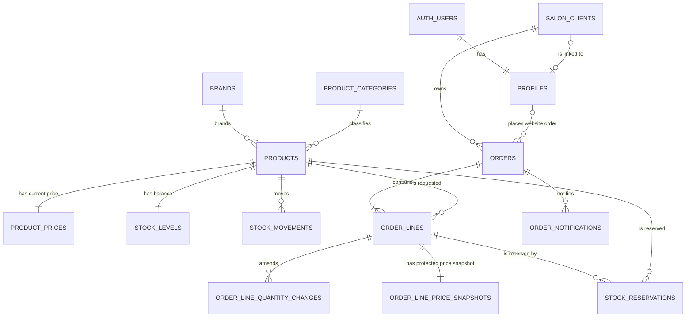

# Proposed Database Design

## Scope

This is a practical, proposed design for the first course-project version. It is documentation only: it creates no tables, migrations, RLS policies, Storage policies, or Supabase configuration.

The design uses English table and field names. Database values for statuses and sources may later be PostgreSQL enums or validated text columns. Monetary values use `numeric(12,2)` and quantities use positive integers.

## Design principles

- Keep the salon client as the durable business identity. An account can be attached later without moving its orders.
- Keep catalogue information separate from confidential price information.
- Use `bigint generated as identity` keys for application tables. `profiles.id` is the UUID from `auth.users`.
- Add an index for every foreign key and for common administrator lists, such as order status and confirmed delivery date.
- Add database constraints for unique order numbers, non-negative stock, positive line quantities, and valid time ranges.
- Enable RLS on every `public` table. A browser client must never receive a service-role key or a database password.

## Proposed tables

### Identity and salon clients

| Table | Main fields | Purpose and relationships |
| --- | --- | --- |
| `profiles` | `id uuid PK` (also `auth.users.id`), `role`, `approval_status`, `salon_client_id unique nullable FK`, `created_at`, `updated_at` | One row per registered user. `role` is `admin` or `client`; `approval_status` is `pending`, `approved`, or `denied`. Links a registered client to at most one `salon_clients` row. The role and approval fields are server-managed. |
| `salon_clients` | `id bigint PK`, `salon_name`, `contact_name`, `phone`, `email`, `address`, `created_at`, `updated_at` | The salon/customer record. It can exist without a login account. A registered client's editable business/contact fields live here. One salon client has many orders. |

`profiles.salon_client_id` is nullable so an administrator can exist without a salon-client record. For a new client registration, the future application workflow can create a salon client and profile together. For a phone/Viber customer, the administrator creates `salon_clients` only. Later, the administrator links the verified user's profile to that existing row; historical orders remain linked to the same `salon_clients.id`.

### Catalogue

| Table | Main fields | Purpose and relationships |
| --- | --- | --- |
| `brands` | `id bigint PK`, `name unique`, `is_hidden`, `sort_order` | A product brand. A hidden brand and all its products are excluded from public access. |
| `product_categories` | `id bigint PK`, `name`, `product_group`, `sort_order` | Categories for dyes, developers, hair-care products (such as masks and conditioners), and technical products. |
| `products` | `id bigint PK`, `brand_id nullable FK`, `category_id nullable FK`, `article_code nullable unique`, `series_name nullable`, `name`, `description`, `size_label`, `shade_number`, `shade_name`, `shade_color`, `developer_concentration`, `image_path`, `is_hidden`, `is_recommended`, `created_at`, `updated_at` | One sellable shade/size combination per row. `article_code` remains text and is unique when provided; `series_name` is independent of category. `size_label` stays text for bottles, ampoule packs, and kits. `developer_concentration` preserves labels such as `20 VOL`. Hidden drafts require only a name; publishing additionally requires brand, category, a non-blank size/pack description, and a retail price. |
| `product_prices` | `product_id PK/FK`, `retail_price`, `salon_sale_price`, `reference_purchase_price`, `updated_at`, `updated_by` | Current prices including VAT. This is an administrator-only table in a non-exposed schema, such as `private`. |

`products` deliberately has no price columns. Catalogue queries can expose only visible product metadata and images. Recommended products sort first **after** the active filters are applied, then ordinary product sorting applies.

An administrator creates and edits products and descriptions. Missing inventory data is treated as **not entered**, not as proof that a product is out of stock. An unclear price-list entry is omitted from the first import and completed later by an administrator; neither prices nor stock quantities are invented.

### Orders and notifications

| Table | Main fields | Purpose and relationships |
| --- | --- | --- |
| `orders` | `id bigint PK`, `order_number unique`, `salon_client_id FK`, `placed_by_profile_id nullable FK`, `source`, `status`, requested and confirmed delivery fields, contact/address snapshots, `delivery_instructions`, `customer_note`, `denial_reason`, `delivered_at`, `created_at`, `updated_at` | The order header. `placed_by_profile_id` is populated for website orders and may be null for phone/Viber orders. Snapshots preserve the historical contact/address details. |
| `order_lines` | `id bigint PK`, `order_id FK`, `product_id FK`, product/size/article/brand/series/shade/developer snapshots, `quantity`, `is_current`, `replaced_at`, `created_at` | The products and positive quantities requested. Server-side snapshots keep the order readable if a product is later renamed, hidden, archived, or moved to another brand/series. |
| `order_line_quantity_changes` | `id bigint PK`, `order_line_id FK`, `previous_quantity`, `new_quantity`, `changed_by_profile_id`, `operation_request_id`, `changed_at` | Immutable audit record created before an approved current line's quantity is changed. |
| `order_line_price_snapshots` | `order_line_id PK/FK`, `retail_price`, `salon_sale_price`, `reference_purchase_price`, `currency` | One protected price snapshot for each order line. It is separate from client-readable order lines so clients cannot obtain prices through the public API. |
| `order_notifications` | `id bigint PK`, `order_id FK`, `channel`, `status`, `attempt_count`, `last_error`, `next_retry_at`, `sent_at` | Reserved audit foundation for a future server-side email notification. Email delivery is deferred; when enabled, a failed email must not roll back the order and can be retried. |

The application creates an order with its line snapshots atomically. Clients can read their own non-price order data but cannot directly update or cancel submitted orders. Administrators record any agreed change or cancellation.

The confirmed normal workflow is `NEW` → `APPROVED` → `IN_PROGRESS` → `DONE`.
`DENIED` may be reached from `NEW`, `APPROVED`, or `IN_PROGRESS`; it requires a
reason and releases active reservations. `DONE` and `DENIED` are terminal.
Administrator-created phone/Viber orders may begin at `APPROVED` or `IN_PROGRESS`.

### Inventory and reservations

| Table | Main fields | Purpose and relationships |
| --- | --- | --- |
| `stock_levels` | `product_id PK/FK`, `physical_quantity`, `reserved_quantity`, `updated_at` | One current balance per product. Available quantity is calculated as `physical_quantity - reserved_quantity`; it is not stored separately. Both values are non-negative and reserved quantity cannot exceed physical quantity. |
| `stock_movements` | `id bigint PK`, `product_id FK`, `movement_type`, `quantity_delta`, `reason`, `order_id nullable FK`, `created_by_profile_id FK`, `created_at` | Immutable audit trail for receipts, adjustments, and delivery deductions. |
| `stock_reservations` | `id bigint PK`, `order_line_id FK`, `product_id FK`, `quantity`, `status`, `allocated_by_profile_id FK`, `allocated_at`, `released_at`, `consumed_at` | Each row reserves a positive quantity for an order line. A composite foreign key to `(order_lines.id, order_lines.product_id)` must ensure that the reservation product matches its order-line product. Several active rows may be used for a line when it is supplied in stages. Status is `active`, `released`, or `consumed`. |

## Relationship diagram

## Public catalogue versus administrator-only prices

### Public/client-facing data

The client-facing catalogue reads `brands`, `product_categories`, and the safe fields from visible `products`, plus a safe product-image URL from Supabase Storage. It does not select `product_prices` or `order_line_price_snapshots`.

For implementation, expose a purpose-built read-only catalogue query or a `security_invoker` view containing only safe columns. Its visibility rule must require `products.is_hidden = false`; filtering, recommended ordering, and product details must all use the same rule so a hidden product cannot be read by its ID.

### Administrator-only data

Store current product prices and historical line-price snapshots in a non-exposed `private` schema. Do not grant `anon` or ordinary `authenticated` users direct access to those tables. Administrator screens obtain price data through an administrator-authorized server-side operation or a carefully protected query.

This separation is necessary because RLS controls rows, not a convenient guarantee that a client cannot request sensitive columns. A client-safe orders query should likewise omit price snapshots. The service role remains server-only.

## Profiles, approval, and administrator protection

- `profiles.id` maps to the current Supabase Auth user. RLS ownership checks use `auth.uid()` and a matching profile/salon-client relationship.
- A pending client can select and update only their linked `salon_clients` contact fields. They cannot create website orders until their profile is approved.
- An approved client can select their linked order headers and lines, while a pending or unrelated client cannot. Order price snapshots are never exposed to this client query.
- Client-facing updates do not write `profiles.role`, `profiles.approval_status`, or `profiles.salon_client_id`. These are changed only through administrator-controlled server-side operations.
- Administrator access must be determined from server-managed role data, never from mutable `user_metadata`. Future RLS policies may use a narrowly scoped, audited `is_admin()` helper or a protected app-metadata claim, but must account for stale JWTs after a role change.
- Each public table gets RLS enabled and least-privilege policies. A policy that permits updates must include both its ownership test and a `WITH CHECK` condition.

## Initial stock-shortage workflow

1. A submitted `NEW` order changes no stock balance and creates no reservation.
2. When an administrator approves an order, a single server-side transaction locks the appropriate `stock_levels` rows. It reserves only the available units by increasing `reserved_quantity` and creating matching `active` `stock_reservations` rows. Any remainder stays outstanding on the order line.
3. A stock receipt increases `physical_quantity` and writes a receipt `stock_movements` row. It does not automatically assign the newly available units.
4. The administrator explicitly allocates received units to waiting order lines. The same atomic allocation transaction rechecks availability, increases `reserved_quantity`, and adds an active reservation. It cannot allocate more than the available quantity.
5. Delivery is allowed only when the total active reservation quantity for **every** order line equals the requested line quantity. Delivery then atomically deducts physical stock, decreases reserved stock, adds delivery movements, and marks those reservations `consumed`.
6. Denial releases active reservations in one transaction by decreasing `reserved_quantity` and marking the reservations `released`. It does not change physical stock.

For an approved-order edit, the server reconciles old and new reservations in one transaction before persisting the change. A retained product line keeps its original product and price snapshots; a quantity change writes an immutable quantity-audit record first. A genuinely new/replacement product receives a new current-price snapshot. Delivery and denial operations must be idempotent: a repeated request sees the already-consumed or already-released reservation state and makes no second stock change.

The database transaction, row locking, constraints, and reservation audit rows—not the user interface—prevent a unit from being allocated twice or availability from becoming negative. Separate concurrent-session tests are deferred for this iteration, but these database protections remain required.

## Implementation notes for later migrations

- Use foreign keys with `ON DELETE RESTRICT` (or archive records) for products referenced by order lines. Do not delete historical products.
- Add indexes for each foreign key, including `orders.salon_client_id`, `order_lines.order_id`, `stock_reservations.order_line_id`, and the profile/order ownership path.
- Add practical list indexes such as `orders(status, confirmed_delivery_date)` for the new-order count and Today view, and product-list indexes supporting visible/category/recommended ordering.
- Keep reports as administrator-only queries over current order lines from `DONE` orders and `delivered_at`; they are not source-of-truth tables in the first version. The initial report uses inclusive Europe/Sofia calendar dates and returns total units plus a `product_id`-grouped product breakdown with the latest in-range line snapshot. Salon-client, brand, and financial reporting are deferred.
- Implement all schema and policy changes later as reviewed SQL migrations, then test RLS with visitor, pending-client, approved-client, and administrator accounts.
