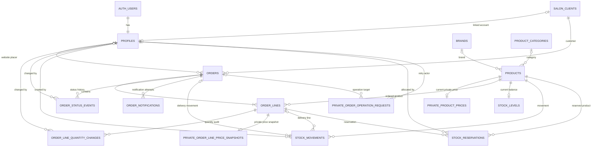

# Database relationships

This diagram reflects the tables and foreign keys in the committed migrations under `supabase/migrations/`. It is an implementation-oriented map, not a replacement for the migration SQL or RLS policies.

`AUTH_USERS` represents Supabase Auth. Tables prefixed with `PRIVATE_` are in the `private` schema and are not browser-readable tables.

## Notes

- `profiles.salon_client_id` is unique and nullable, so a salon client may exist without a login and a profile may exist without a linked salon record.
- `orders` retain customer/contact snapshots; `order_lines` retain product snapshots. Historical readability therefore does not depend on current salon or product fields.
- `stock_reservations` has a composite foreign key to the matching `(order_lines.id, order_lines.product_id)` pair, preventing a reservation from naming a different product than its order line.
- `private.product_prices`, `private.order_line_price_snapshots`, and `private.order_operation_requests` are intentionally separated from client-readable data. Public RPCs enforce the permitted write paths and reuse request UUIDs for safe retries.
- Price-list PDF objects are stored in the Supabase Storage bucket `price-lists`; they are not relational-table entities and are therefore not shown in the diagram.
